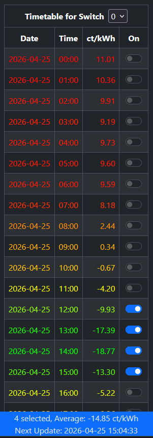
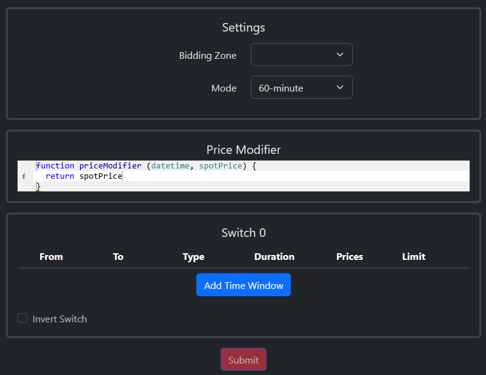

# Spot-Price Based Control of Shelly Devices

Spotelly is a script that switches the outputs of a Shelly device based on EPEX spot prices. It
runs directly on the Shelly and works with all Gen2+ Shelly switches. The only requirement is that
the Shelly has internet access.

## How It Works

1. You define one or more time windows for the day, for example from 7:00 to 19:00.
2. For each time window, you define how long the output should be on, for example 4 hours.
3. Every day shortly after 15:00, the script downloads the EPEX prices for the next day and
   schedules the output for the cheapest periods in each time window. In this example, these are
   the 4 cheapest hours between 7:00 and 19:00.

You can review and adjust the schedule in the timetable view:

<p align="center">
  
</p>

## Features

- Built-in configuration UI for easy setup.
- Works with 60-minute or 15-minute prices to match your contract.
- Separate rules for each switch on multi-switch devices.
- Time windows can select the highest prices instead of the lowest, for example to discharge a
  battery when prices are high.
- Optional price limits switch the output on only below (or above) a threshold in ct/kWh.
- A custom price modifier includes time-dependent costs such as variable grid fees in the
  calculation.
- If the price server is unavailable, a fallback mode calculates the schedule from statistical
  prices.
- An event on every switching check lets your own scripts extend the functionality.

The prices are provided by [energy-charts.info](https://energy-charts.info), which generously
offers unrestricted access to its EPEX price API. The license of the price data depends on your
location; see the [API documentation](https://api.energy-charts.info/#/prices) for details.

## Installation

### Prerequisites

- The Shelly firmware must be version 1.7.5 or later.
- On Gen3 devices, Matter must be disabled. Enabling Matter reduces the memory available for
  scripts, and the script cannot run with the reduced memory.

### Steps

1. Open the IP address of your Shelly in a browser.
2. Open the `Scripts` tab and click `Create Script`.
3. Copy the complete source code of [dist/final.js](./dist/final.js) into the script editor.
4. Optional: enter a script name.
5. Click `Save`, then `Start`.
6. Return to the `Scripts` tab and check that the status below the script name is `Running`. Note
   the script ID that the Shelly has assigned to the script. You need it to open the
   configuration and timetable pages.
7. Enable `Run on startup` so that the script restarts after a reboot.
8. Continue with the [configuration](#configuration).

## Configuration

The script stays idle until a configuration has been submitted. To configure it, open
`http://<shelly_ip>/script/<script_id>/config` in a browser:

<p align="center">
  
</p>

### Settings

#### Bidding Zone

The bidding zone that matches your location or contract.

#### Mode

The price resolution that matches your contract. In `60-minute` mode, the script uses hourly
prices; in `15-minute` mode, it uses quarter-hourly prices for all calculations and in the
timetable.

Changing the mode removes all time windows.

### Price Modifier

By default, the script uses the plain EPEX spot price. Your actual price usually contains further
components such as fees and taxes, and some of them vary, for example grid fees that depend on the
time of day or the season.

The price modifier lets you add these components. The script uses the modified price to select the
periods and shows it in the timetable.

In the configuration UI, you edit the body of the `priceModifier` function. It receives the start
time of the period as a `Date` object (`datetime`) and the EPEX price in ct/kWh (`spotPrice`), and
returns the price that the script should use.

For example, a grid operator charges 10 ct/kWh during the peak hours from 7:00 to 9:00 and from
18:00 to 20:00, and 8 ct/kWh for the rest of the day:

```javascript
function priceModifier(datetime, spotPrice) {
  const hour = datetime.getHours();
  if (hour === 7 || hour === 8 || hour === 18 || hour === 19) {
    return spotPrice + 10; // peak hours
  }
  return spotPrice + 8; // all other hours
}
```

The logic can be as complex as you need, as long as the function always returns a number. Prices
are rounded to two decimals in the timetable.

The code is limited to 1024 bytes. If the code exceeds this limit or contains a syntax error, the
configuration UI shows a warning and the configuration cannot be submitted.

If you do not need a price modifier, keep the default `return spotPrice;`.

### Switch Settings

The configuration UI shows one card for each switch of the device. Here, you define the time
windows and their rules. You can define up to 30 time windows in total and distribute them across
the switches as needed. The script only controls switches that have at least one time window.

Click `Add Time Window` to add a time window, then set the following fields.

#### From and To

The start and end time of the time window. The end time must be later than the start time.

#### Type

How the script selects the periods within the time window:

- `block`: one contiguous block of the given duration with the lowest (or highest) average price.
- `non-block`: the periods with the lowest (or highest) prices, whether or not they are contiguous.

#### Duration

How long the output is on within the time window, for example `3h 45m`. In 60-minute mode, the
duration is set in whole hours; in 15-minute mode, in steps of 15 minutes. The duration cannot be
longer than the time window.

#### Prices

Whether the script selects the periods with the `lowest` or the `highest` prices.

#### Limit

An optional price limit in ct/kWh. Leave the field empty for no limit.

- With `lowest` prices, the limit is a maximum. With a limit of `10`, the output is only switched
  on in periods with a price of 10 ct/kWh or less.
- With `highest` prices, the limit is a minimum. With a limit of `10`, the output is only switched
  on in periods with a price of 10 ct/kWh or more.

The limit can be negative and can have decimals, for example `10.5`. Always use a decimal point,
not a comma, regardless of your locale.

#### Invert Switch

Inverts the switching logic, which some wiring setups require:

- Unchecked: the switch is on during the selected periods and off for the rest of the day.
- Checked: the switch is off during the selected periods and on for the rest of the day.

### Submitting the Configuration

Click `Submit` to save the configuration. The button is disabled until at least one time window is
defined. The script then calculates the schedule for the current day:

- The calculation uses all prices of the day, but periods that are already over are removed from
  the timetable. You therefore only see the remaining part of the day.
- If you submit after 15:00, the script also calculates the next day right away. Otherwise, the
  next day is calculated shortly after 15:00 as usual.

## Timetable

To review the schedule, open `http://<shelly_ip>/script/<script_id>/spotelly` in a browser. You
can switch individual periods on or off there.

On multi-switch devices, the timetable shows the first controlled switch by default. Use the
dropdown to select another switch, or open the timetable of a specific switch directly:
`http://<shelly_ip>/script/<script_id>/spotelly?id=<switch_id>`

## Extending the Script

At every full hour (60-minute mode) or quarter hour (15-minute mode), the script checks its
schedule and sets all controlled switches accordingly. Each check emits a `spotelly_tick` event
with the following data:

```javascript
{
  current_price: 10, // price for the current period (NaN in fallback mode)
  next_price: 12,    // price for the next period (NaN in fallback mode)
  // one entry for each controlled switch, included even if the state has not changed
  switch_0: true,    // switch state for the current period
  switch_2: false
}
```

You can handle this event in a separate script. This example prints the event data to the console:

```javascript
Shelly.addEventHandler(function (event) {
  if (event.name === "script" && event.info && event.info.event === "spotelly_tick") {
    const data = event.info.data;
    console.log("The current price is", data.current_price, "ct/kWh.");
    console.log("The next price will be", data.next_price, "ct/kWh.");
    console.log("Switch 0 is", data.switch_0 ? "ON." : "OFF.");
    console.log("Switch 2 is", data.switch_2 ? "ON." : "OFF.");
  }
});
```

Possible uses include:

- Forwarding switch commands to other devices in your network, Shelly or otherwise.
- Showing the current or next price in a virtual component or on a display.
- Sending notifications through your preferred service.
- Updating the Shelly Cloud Live Tariff with the current price.

Because your code runs in its own script, it is not affected when you update Spotelly to a new
version.

## FAQ

### How do I update to a new version?

Unless the [CHANGELOG](./CHANGELOG.md) lists specific upgrade steps:

1. Stop the script.
2. Replace the entire script code with the new version.
3. Save and start the script.

The script loads the stored configuration automatically.

### How do I modify the script or the web UI?

To save memory on the Shelly, a build script compresses the HTML files of the configuration and
timetable pages and embeds them into the script. Changes to the script or the web UI therefore
require this build step.

You need a recent version of Node.js. Clone the repository and install the development
dependencies:

```
git clone https://github.com/towiat/spotelly
cd spotelly
npm install
```

Then, for each change:

1. Edit the files in the `src` folder.
2. Run `npm run build`.
3. Install `dist/final.js` on your Shelly.

The build script `build.js` describes the compression and merge process in detail.

### The timetable shows `NaN` instead of prices and no colors. What happened?

The script is in fallback mode because it could not download the prices for the next day, for
example due to network problems or an outage of the price server.

The fallback works as follows:

- The script first tries to download the prices shortly after 15:00.
- If that fails, it retries every 20 minutes until 23:30.
- If all attempts fail, the script calculates the schedule from built-in statistical prices for an
  average day. You can adjust the result in the timetable.
- The timetable shows `NaN` instead of the statistical prices and no color coding, to indicate
  that real prices were unavailable.

The process starts again the next day. Once the cause is resolved, the script returns to normal
operation automatically. The color coding returns once the last `NaN` value has left the
timetable.

### Where can I ask questions or give feedback?

Open an issue in this repository, or post in the
[thread on the Shelly community forum](https://community.shelly.cloud/topic/15202-script-price-based-control-of-shelly-devices/),
which I monitor.

## Support

If you find this useful, consider buying me a coffee:

<a href="https://www.buymeacoffee.com/towiat" target="_blank"></a>
